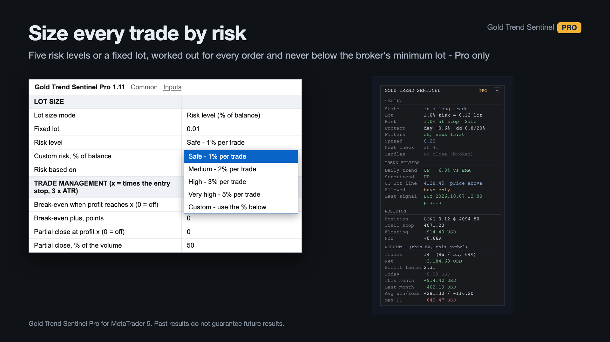
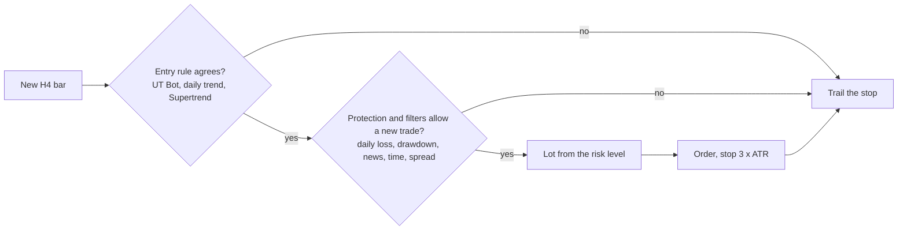
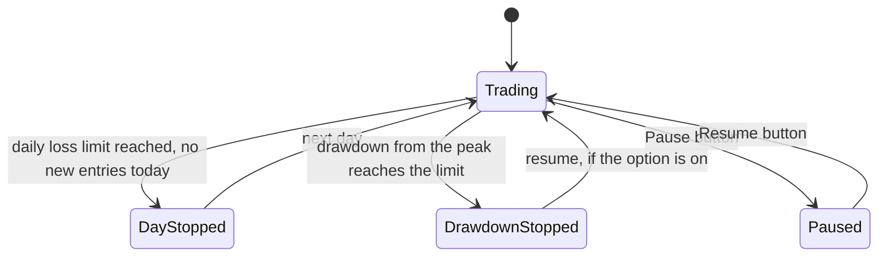
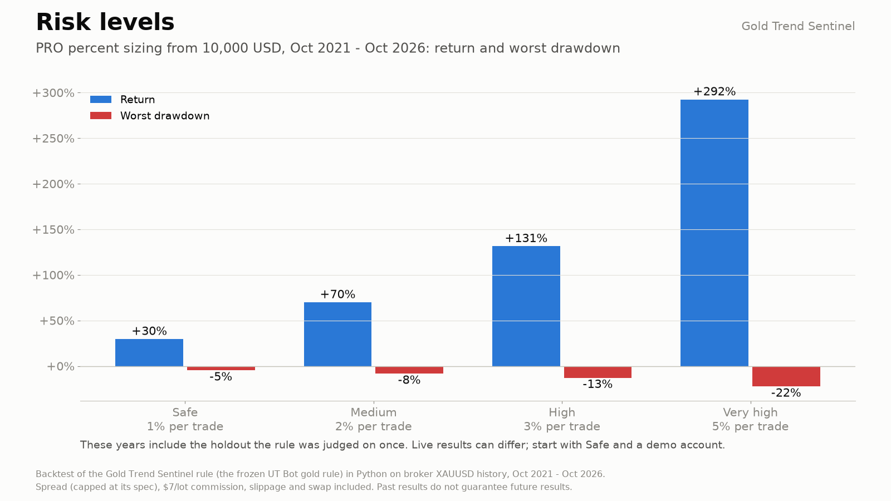
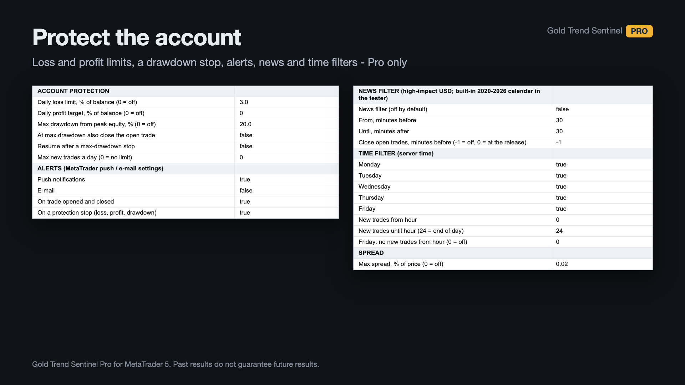
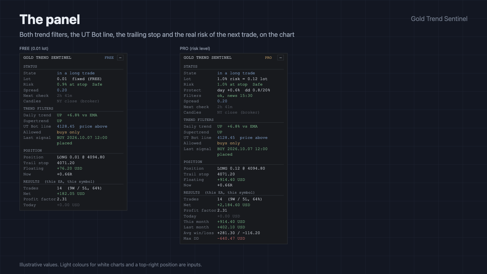
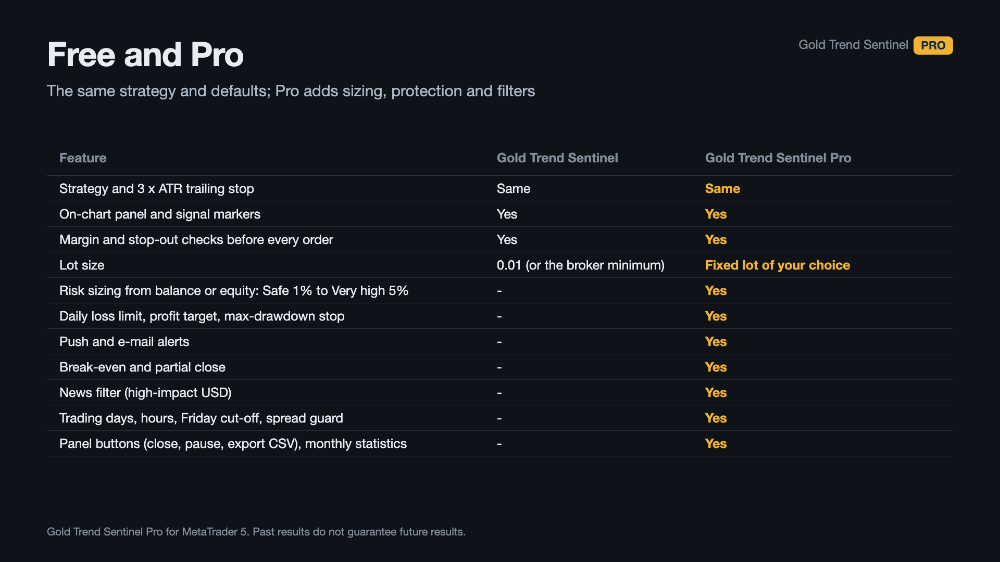
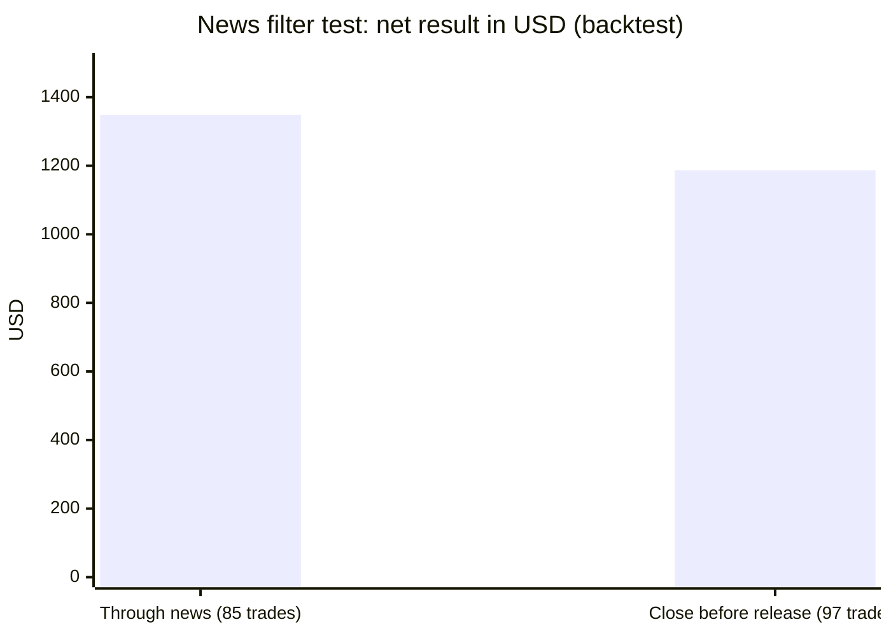

# Gold Trend Sentinel PRO (MetaTrader 5 and MetaTrader 4)

An XAUUSD Expert Advisor that sizes each trade from a risk level, stops itself on a daily loss or drawdown limit, and can pause
around high-impact USD news. The entry rule is the same one as in the free Gold Trend Sentinel. The evidence is **promising but
unproven**, as stated below.

> **This is a showcase repository: documentation and images only. There is no source code here.** The product is sold on
> the MQL5 Market. The free edition, with the same entry rule at a fixed 0.01 lot, has public source:
> [allanninal/gold-trend-sentinel](https://github.com/allanninal/gold-trend-sentinel).

**Website:** [allanninal.dev/mql5/gold-trend-sentinel](https://www.allanninal.dev/mql5/gold-trend-sentinel/) · [MT4 editions](https://www.allanninal.dev/mql5/#mt4) · [allanninal.dev](https://www.allanninal.dev)
· **Contact:** message me on [LinkedIn](https://www.linkedin.com/in/allanninal/).

> This EA promises no profit. The protection limits exposure; it does not remove the risk of loss. Every result here is a
> backtest, not live trading.

## Get it on the MQL5 Market

| Product | Platform | Price | Link |
|---|---|---|---|
| **Gold Trend Sentinel PRO** | MT5 | paid | <https://www.mql5.com/en/market/product/201334> |
| **Gold Trend Sentinel Pro MT4** | MT4 | paid | MT4 edition: coming soon on the MQL5 Market |
| Gold Trend Sentinel (source on GitHub) | MT5 | free | <https://www.mql5.com/en/market/product/200427> |
| Gold Trend Sentinel MT4 (source on GitHub) | MT4 | free | MT4 edition: coming soon on the MQL5 Market |

The PRO edition is standalone: you do not need to install the free one. Details, current price and the Strategy Tester demo are
on the Market pages.

## What it does

- **The entry rule (same as the free edition):** on each new H4 bar, a buy needs a close above the UT Bot line, a daily close above
  its 200-day EMA and an upward Supertrend; a sell is the reverse. The stop starts at 3 x ATR and trails. There is no take profit.
  One position at a time. XAUUSD only (prefixed or suffixed names are fine); the Strategy Tester accepts any symbol.
- **Lot sizing by risk level:** Safe 1%, Medium 2%, High 3%, Very high 5% or a custom percent of balance (or equity) lost if the
  stop is hit, never below the broker's minimum. A fixed-lot mode exists.
- **Protection:** a daily loss limit (3% by default), an optional daily profit target, a maximum drawdown from peak equity (20% by
  default) with optional closing of the open trade, and a cap on new trades per day. Protection and filters block new entries
  only, never exits.
- **Options:** break-even and partial close (off), a time filter, a spread guard (no new trade above 0.02% of price), push and
  e-mail alerts.
- **News filter**, off by default so the entry rule runs as tested: it blocks new trades around high-impact USD releases (NFP,
  CPI, FOMC and similar), with an option to close an open trade before the release. Live charts read the terminal's
  calendar; the Strategy Tester has none, so a built-in list of 556 events from 2020 to 2026 is used there.
- **Panel:** lot, risk, protection and filter rows, the open trade, monthly results, largest drawdown, the next release, and
  buttons to close (with confirmation), pause or resume, and export closed trades to CSV.

### What the protection can do

| | |
|---|---|
|  |  |
|  |  |

The charts of the entry rule's backtest are in [`images/mt5/`](images/mt5): [how a trade works](images/mt5/01-how-it-works.png),
[UT Bot vs buying gold](images/mt5/02-equity-vs-gold.png), [drawdown](images/mt5/03-drawdown.png),
[results by year](images/mt5/04-results-by-year.png), [results by month](images/mt5/05-results-by-month.png),
[trade results in R](images/mt5/06-trade-results-R.png), [buys and sells](images/mt5/07-buys-and-sells.png). The MT4 edition's
screenshots are in [`images/mt4/`](images/mt4). They are illustrations built from broker history, not terminal captures.

## Who it is for

Traders who want to choose a risk level, have loss and drawdown limits applied automatically and test news handling on history.
Not for frequent trades, a per-trade profit target or other symbols. For a fixed 0.01 lot, the free
[Gold Trend Sentinel](https://www.mql5.com/en/market/product/200427) is enough.

## Why it was built

- The entry rule is a frozen result of a gold research project: a pre-registered search over about 105,000 settings in which **no
  family passed the deflated-Sharpe test**. The UT Bot H4 rule was the most promising in a one-shot holdout ("promising,
  unproven").
- **Weak demand, stated plainly.** Gold trend followers are crowded on the MQL5 Market and we found no demand specific to this
  rule. PRO adds what most traders ask of any EA: sizing, loss limits and filters around a frozen rule.
- It pairs with the free edition, which has public source and the same entry rule.

## Results of the checks

Backtest, not live trading: Python, XAUUSD broker history, October 2021 to October 2026, from 10,000 USD, spread, commission,
slippage and swap included, 85 trades. The rule was chosen on research data and judged once on 2024 to 2026, so this is **not new
out-of-sample evidence**; a forward test started in October 2026 is not finished.

Risk level (backtest return and worst drawdown):

| Risk level | Risk per trade | Return | Worst drawdown |
|---|---:|---:|---:|
| Safe | 1% | +30% | -5% |
| Medium | 2% | +70% | -8% |
| High | 3% | +131% | -13% |
| Very high | 5% | +292% | -22% |

```mermaid
xychart-beta
    title "Return and worst drawdown by risk level (backtest, %)"
    x-axis ["Safe 1%", "Medium 2%", "High 3%", "Very high 5%"]
    y-axis "%" -30 --> 300
    bar [30, 70, 131, 292]
    bar [-5, -8, -13, -22]
```

(First series return, second worst drawdown. Higher levels magnify losing streaks too.)

Fixed 0.01 lot, default inputs, 2020 to October 2026: the worst drawdown was 5.4% over the 2021 to 2026 period; at Safe 4.7%, at
Medium 8.3%. The news filter, tested separately (Python, XAUUSD, 2020 to October 2026, fixed 0.01 lot):

| News setting | Trades | Net | Worst drawdown |
|---|---:|---:|---:|
| Trading through news (default) | 85 | +1,348 USD | 635 USD |
| Pause 30 minutes either side | 85 | the same | the same |
| Also close open trades 30 minutes before each release | 97 | +1,187 USD | 186 USD |

It did not beat trading through news in both halves of the period, hence it is off by default.

| Check | Result |
|---|---|
| Code checks (Python copies of the EA's indicator code and trade handling vs the research rule, H4 history, Oct 2021 to Oct 2026) | 112 of 112 signals, 85 of 85 trades identical |
| MT4 publish gate, Python half (entries 2023-07 to 2026-09) | PASS: 58 trades, mean R +0.447, t 2.65, PF 3.01 |
| MT4 publish gate, MT4 Strategy Tester half (every tick) | PASS: 57 trades vs 58, signals 74 of 74 identical, mean R +0.433, t 2.53, PF 2.86; the news pause (30 before, 15 after) gave the same trades |
| MT4 validator-style runs (default inputs, 2025-10 to 2026-10, every tick) | PASS, 0 error lines on all 12 runs for the two MT4 editions |

These are code checks and a backtest, not trading results.

## Honest limits

- No proven edge: the rule was picked from about 105,000 settings, survived a one-shot holdout, and has not been through forward
  trading yet. Most of the profit came from buys in a rising gold market; sells lost slightly.
- The stop on gold is about 115 USD per 0.01 lot in 2026. At the Safe level, below roughly 12,000 USD even the minimum lot risks
  more than 1%, and the panel says so.
- Costs and fills in the backtest are modelled, not guaranteed live. Keep the terminal running, or use a VPS.
- Live news filtering reads the terminal's calendar and differs from the tested built-in list.
- The source is not published; this repository documents what the product does and the results of its checks.

## Free vs paid

| | Gold Trend Sentinel (free) | Gold Trend Sentinel PRO (paid) |
|---|---|---|
| The entry rule and the trailing stop | yes | yes |
| Lot | fixed 0.01 (or the broker minimum) | risk levels or a fixed lot |
| Daily loss and drawdown limits, trade cap | no | yes |
| News, time and spread filters, break-even, partial close, alerts | no | yes |
| MT5 | [200427](https://www.mql5.com/en/market/product/200427) | [201334](https://www.mql5.com/en/market/product/201334) |
| MT4 | coming soon | coming soon |
| Source | [public on GitHub](https://github.com/allanninal/gold-trend-sentinel) | not published |

---

**Website:** [allanninal.dev/mql5/gold-trend-sentinel](https://www.allanninal.dev/mql5/gold-trend-sentinel/) · [MT4](https://www.allanninal.dev/mql5/#mt4) · [allanninal.dev](https://www.allanninal.dev)
· Questions: message me on [LinkedIn](https://www.linkedin.com/in/allanninal/). All rights reserved, see [LICENSE](LICENSE).
